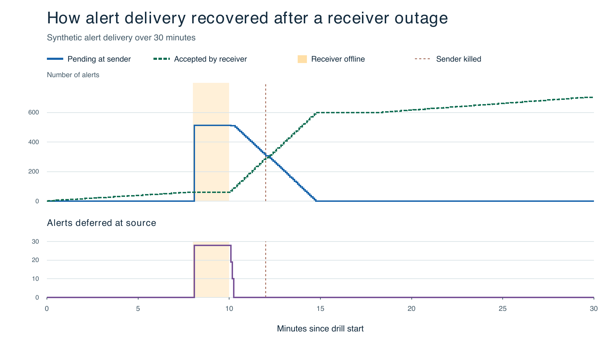

# Recovering an alert backlog

A local sender had 600 synthetic alerts to account for when its receiver went offline. The receiver had already accepted 60. This 30-minute drill tested where the remaining alerts waited and whether the sender could finish after a forced restart.



| Observation | Result |
| --- | ---: |
| Receiver offline | About 120 seconds |
| Highest sampled pending count / queue capacity | 512 / 512 |
| Highest sampled count deferred at the source | 28 |
| First sample showing the outage backlog drained, measured from receiver restart | About 4 min 45 sec |
| Final produced / accepted | 702 / 702 |
| Final pending / deferred | 0 / 0 |
| Total attempts / transport errors | 934 / 232 |

**During the outage.** The sender kept unacknowledged alerts in its saved queue. Once the queue filled, later alerts waited at the source. Failed delivery attempts could therefore increase while the receiver's accepted count stayed flat.

**During recovery.** The receiver restarted first. The drill then killed and restarted the sender while the backlog was draining. We measured recovery at the first sample with all 600 outage-period alerts accepted and zero pending or deferred. Later steady traffic brought the final source count to 702.

Samples were scheduled every 5 seconds, with extra readings around events. The drain time identifies a sampled observation. The actual last delivery could have occurred between readings. Sender and receiver counts were read separately, so individual rows can briefly disagree.

## Reproduce the public numbers

Run the checker from the repository root.

```sh
python3 -B case-studies/alert-outage/check.py
```

The checker reads the [sampled counters](samples.csv) and [recorded event times](events.csv), recalculates the peaks, final counts and recovery interval, and compares them with the [published summary](summary.json). All times are seconds from the start of this drill.

**What was verified privately.** The receiver's saved sequence matched the original ordered identifiers and payload fingerprints for all 702 synthetic alerts. The public files contain aggregate counts, so you can reproduce the timeline and totals here. Independently checking each alert's identity and order requires the underlying inventory. This result covers one local run with synthetic traffic.
